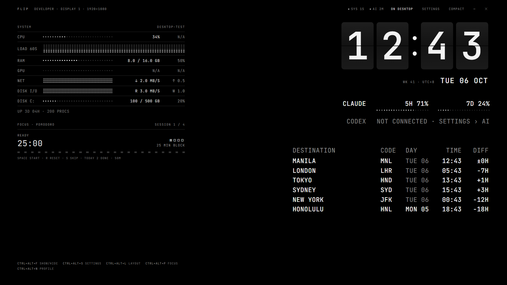
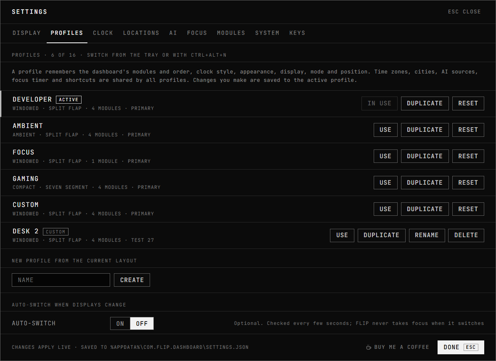
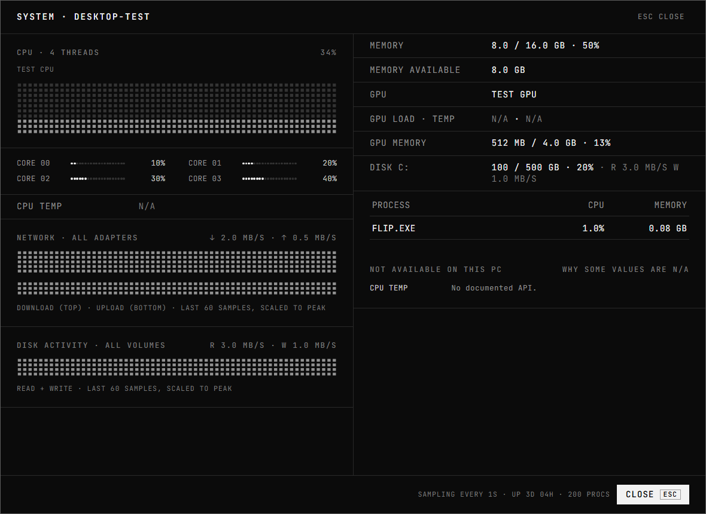
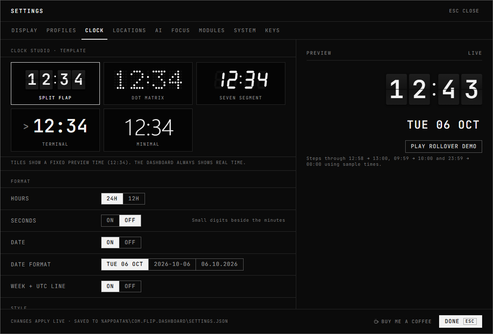
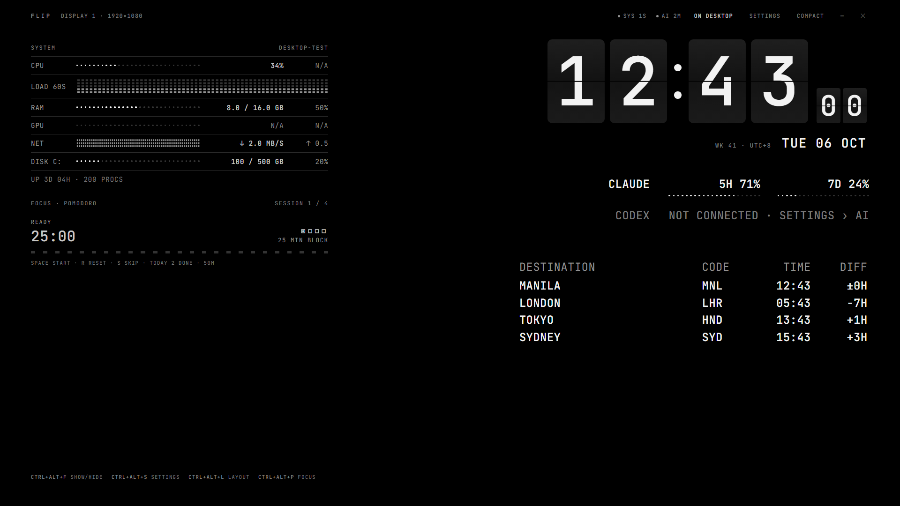
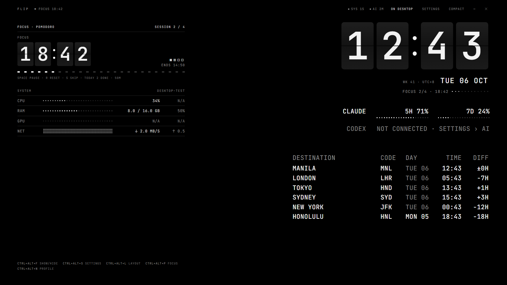
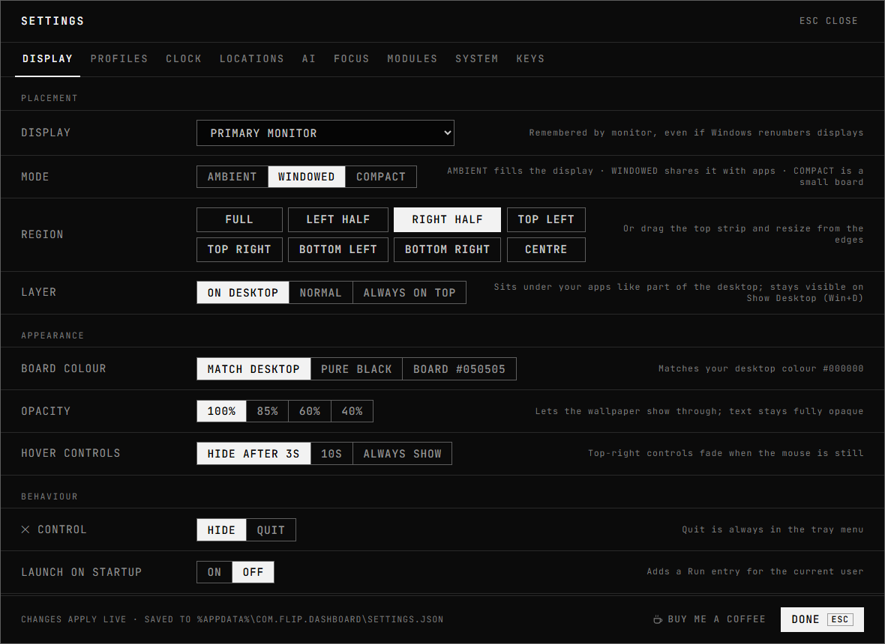
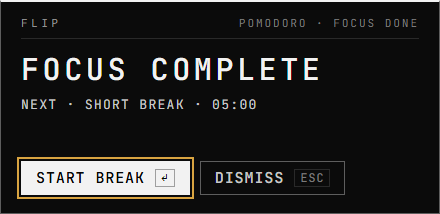
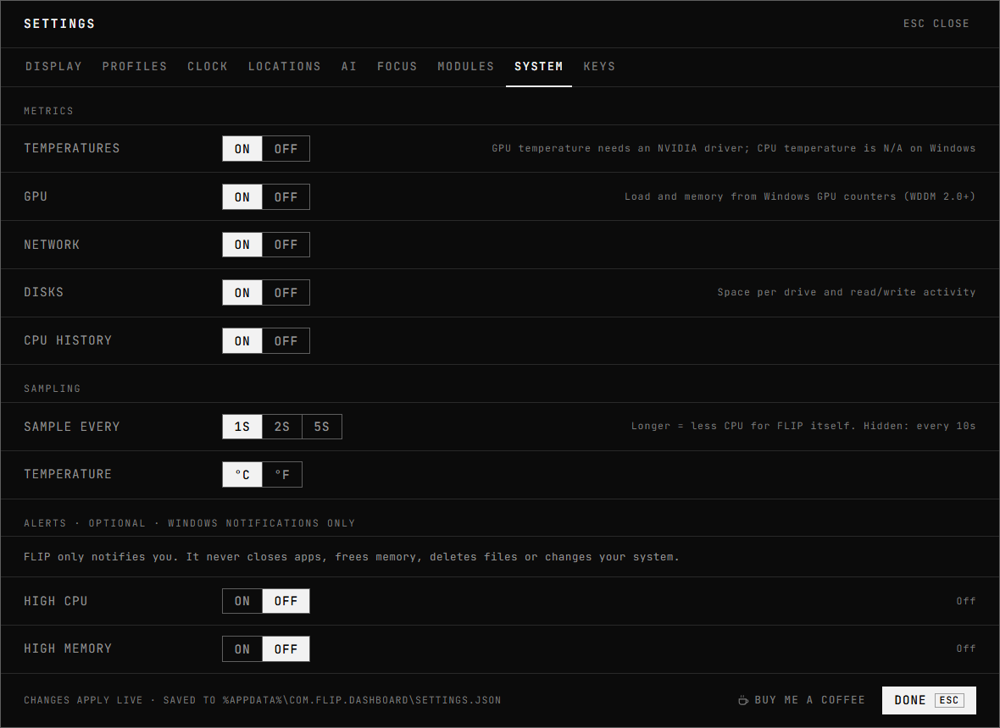

# FLIP — Your Windows Desktop Command Center

**An airport-board dashboard that lives on your Windows desktop: a split-flap clock, world clocks, a focus timer, AI coding-plan usage and live system monitoring, with a profile for every way you work.**



<sub>Rendered from FLIP's own UI with sample data (see [About these images](#about-these-images)). FLIP shows your own clock, cities and system readings, and AI usage only from a source you connect.</sub>

**[Download for Windows](https://github.com/jrulloda14/FLIP/releases/latest)** · free and open source (MIT) · Windows 10 and 11, x64

[](https://buymeacoffee.com/flipdashboard)

FLIP sits on the desktop instead of asking for another app window. It has no title bar, no taskbar button and no Alt+Tab entry. By default it stays under your applications and above the wallpaper, and it is still there when you press Win+D. Pick a clock style, choose what the board shows and where, and save that as a profile you can switch to from the tray or a shortcut.

Everything runs locally. FLIP has no account, no telemetry and makes no network requests.

---

## Contents

[Key features](#key-features) · [Screenshots](#screenshots) · [Download and installation](#download-and-installation) · [First-run guide](#first-run-guide) · [Desktop embedding and display modes](#desktop-embedding-and-display-modes) · [Clock Studio](#clock-studio-and-clock-templates) · [World clocks and focus timer](#world-clocks-and-focus-timer) · [Profiles](#multi-monitor-profiles) · [System monitoring](#windows-system-monitoring) · [AI usage](#ai-usage-integrations) · [Shortcuts and tray](#keyboard-shortcuts-and-tray-controls) · [Privacy and security](#privacy-and-security) · [Limitations](#known-limitations) · [Build from source](#build-from-source) · [Architecture](#architecture-overview) · [Roadmap](#roadmap) · [Support](#support) · [Contributing](#contributing) · [Acknowledgments](#acknowledgments--inspiration) · [License](#license)

## Key features

- **Desktop-embedded, borderless board.** Three layers: on the desktop (default; under your apps, visible on Show Desktop), normal, or always on top (steps aside for fullscreen games and presentations).
- **Three display modes.** Ambient fills a display, Windowed shares it with your apps in one of eight regions, Compact is a small corner board.
- **Clock Studio.** Split flap (default), dot matrix, seven segment, terminal and minimal templates. Only the digits that change animate.
- **Profiles.** Developer, Ambient, Focus, Gaming and Custom built in, plus up to eleven of your own. Each one remembers modules and their order, clock style, appearance, display, mode and position. Profiles can optionally switch when you dock or undock.
- **Monitors remembered by hardware ID**, not by position in Windows' list, so re-plugging or renumbering displays doesn't move FLIP to the wrong screen.
- **System monitor.** CPU total and per core, RAM used and available, disk space and read/write activity, network throughput, GPU load and memory, uptime, process count, NVIDIA GPU temperature. A missing reading shows **N/A** (this PC can't provide it) or **ERR** (a reading failed and is retried), never a fake zero.
- **Optional alerts** for sustained high CPU, high memory and low disk space, with thresholds and cooldowns. FLIP only notifies; it never changes anything on your system.
- **AI coding-plan usage** for Claude (via Claude Code's status line) and Codex (experimental, from local CLI logs), or entered by hand. No API keys, no passwords, no scraping.
- **World clocks and a Pomodoro timer.** IANA time zones with correct daylight saving, in your 12- or 24-hour format with each city's day. A deadline-based timer that survives sleep and restarts, and a FLIP-styled card when a focus session or break ends.
- **Installs per user**, needs no administrator rights, and has an offline installer.

## Screenshots

| Profiles | System detail |
|---|---|
|  |  |

| Clock Studio | Split-flap clock |
|---|---|
|  |  |

| Focus session | Settings › Display |
|---|---|
|  |  |

| Timer-completion card | Alerts (Settings › System) |
|---|---|
|  |  |

### About these images

These images were rendered from FLIP's actual React UI and stylesheets in the development preview (`npm run dev`, then `/preview.html`), at the window sizes shown, with **sample data**: the host name, readings, cities and AI percentages are fixtures, not a real PC. They are not screen captures of the desktop app running on Windows, so they don't show the wallpaper, taskbar, tray menu or how FLIP sits among other windows.

## Download and installation

Get FLIP from **[Releases](https://github.com/jrulloda14/FLIP/releases/latest)**. Each release has two installers. Both install for the current user only (no administrator rights), add a Start-menu entry and include an uninstaller.

| Installer | Size | Use it when |
|---|---|---|
| `FLIP_<version>_x64-setup.exe` | ~2 MB | Almost always. It downloads Microsoft's WebView2 runtime only if your PC doesn't have it (Windows 11 and up-to-date Windows 10 already do). |
| `FLIP_<version>_x64-offline-setup.exe` | ~210 MB | The PC has no internet, or WebView2 is missing and can't be downloaded. Includes Microsoft's WebView2 installer. |

Nothing else is needed: no Node.js, Rust or Visual C++ redistributable.

**Windows SmartScreen.** The installers are not code-signed, so the first time you run one, Microsoft Defender SmartScreen may show *"Windows protected your PC"* because the file is from an unrecognised publisher. That message is about reputation, not a detected threat. If you trust the download, choose **More info**, check the file name, then **Run anyway**. Keep SmartScreen and your antivirus on. If you'd rather not run an unsigned installer, [build FLIP from source](#build-from-source).

Each release lists SHA-256 checksums. To check your download in PowerShell:

```powershell
Get-FileHash .\FLIP_<version>_x64-setup.exe -Algorithm SHA256
```

**Upgrading** keeps your settings. Settings from earlier versions are migrated automatically; your current layout becomes the **CUSTOM** profile.

**Uninstalling:** Windows Settings › Apps › FLIP › Uninstall. Tick *delete app data* to remove your settings too.

## First-run guide

1. **Start FLIP.** It opens in the right half of your primary monitor, on the desktop layer, with the split-flap clock and the **Developer** profile.
2. **Find the controls.** Hover over the top strip: layer, SETTINGS, COMPACT, hide (—) and ✕ appear and fade after 3 seconds. The tray icon is always there; left-click it to show or hide FLIP.
3. **Place it.** Settings › Display: choose a monitor, a mode and a region. In Windowed or Compact you can also drag the top strip and resize from the edges.
4. **Pick a clock.** Settings › Clock. Use *Play rollover demo* to see how the template animates.
5. **Add cities.** Settings › Locations (up to 8).
6. **Connect AI usage (optional).** Settings › AI. See [AI usage integrations](#ai-usage-integrations).
7. **Save a profile.** Settings › Profiles › *New profile from the current layout*. Switch between profiles from the tray, with `Ctrl+Alt+N`, or `N` while FLIP has focus.

If FLIP ends up somewhere you can't see, use the tray menu: **Move to primary display** or **Reset layout and position**.

## Desktop embedding and display modes

FLIP is a borderless tool window. It never shows a title bar, taskbar button or Alt+Tab entry, and switching profiles or modes never takes focus from the app you're using.

| Layer | Behaviour |
|---|---|
| **On desktop** (default) | Pinned under all application windows, above the wallpaper. When you press Win+D or click the desktop, FLIP lifts itself above the desktop so it stays visible, and drops back when you switch to an app. |
| **Normal** | Stacks like an ordinary window. |
| **Always on top** | Above other windows, but steps back while Windows reports a fullscreen app (such as a game) or presentation mode, and returns afterwards. |

| Mode | What it does |
|---|---|
| **Ambient** | Fills the chosen display's work area (taskbar excluded). Best on a second monitor. |
| **Windowed** | A movable, resizable region: full, left or right half, any quarter, or centre. |
| **Compact** | A small board with the clock first. |

- Each mode keeps its own position and region.
- Layouts adapt to the window size (Full, Compact, Mini density) and to display scaling.
- **Displays coming and going:** if FLIP's display is disconnected, it moves to the primary monitor within about 5 seconds and says so in Settings › Display. When the display returns, FLIP moves back. A saved position is reused only if it is visible on that display; otherwise FLIP uses the region preset, so it can't be stranded off-screen.
- Background opacity from 40% to 100% lets the wallpaper show through; text stays fully opaque.

## Clock Studio and clock templates

Settings › Clock restyles the main clock. Every template shows real time from the same per-second tick.

| Template | Look |
|---|---|
| **Split Flap** (default) | Mechanical airport-board cards. A changing digit's upper half falls on a hinge and the new lower half swings down. Only changed digits flip, so 12:59 → 13:00 flips three cards. Optional panel seam, shadow, and graphite or black cards. |
| **Dot Matrix** | FLIP's original 5×7 LED dots, round or square, with optional unlit "ghost" dots. |
| **Seven Segment** | Slanted LED segments, optionally with faint unlit segments. |
| **Terminal** | Monospaced console text with a prompt. |
| **Minimal** | Large, light numerals. |

Shared options: 12/24-hour, seconds, date and format, week + UTC line, size, digit spacing, digit colour (bright, soft or dim), colon blink, and digit animation on/off at 250, 320 or 400 ms.

Animation turns off automatically when Windows' *Animation effects* setting is off. After sleep, each digit flips once to the current time instead of replaying missed minutes. The rollover demo uses clearly labeled sample times.

## World clocks and focus timer

**World clocks** (Settings › Locations, up to 8 cities) use IANA time zones, so daylight-saving changes are always right. Times follow the main clock's 12/24-hour setting (`1:48 PM` or `13:48`). The **DAY** column shows each city's weekday and date: dimmed when it's the same day as at home, lit when the city is already on tomorrow or still on yesterday. **DIFF** is the offset from your home zone.

**Focus timer** (Settings › Focus): a Pomodoro timer with focus, short-break and long-break lengths, sessions before a long break, and optional auto-start. It counts to a deadline rather than ticking down, so it stays right across sleep and restarts.

**When a timer ends,** FLIP shows its own card in the bottom-right corner of the dashboard's screen, not a Windows notification or message box:

| Finished | Card | Actions |
|---|---|---|
| Focus session | **FOCUS COMPLETE**, with the next break and its length | **Start break** (Enter) · **Dismiss** (Esc) |
| Break | **BREAK COMPLETE**, with the next session | **Resume focus** (Enter) · **Dismiss** (Esc) |

- The card appears above other windows **without taking focus**, so whatever you're typing in keeps the keyboard. Click it to use the keys.
- **Dismiss** only closes the card; the timer stays exactly as it is. Starting, pausing or skipping the timer from anywhere else (tray, shortcut, dashboard) closes the card too.
- It appears once per completion, even if FLIP is hidden or you change display mode. While a fullscreen game or presentation runs, the card waits and appears when it ends.
- With **auto-start** on, the next phase has already started, so the card says so and only offers Dismiss.
- Turn the cards off separately for focus and breaks, and turn on an optional **sound** (your Windows notification sound; off by default), in Settings › Focus › When a timer ends.

## Multi-monitor profiles

A profile is a saved dashboard layout. Each profile remembers:

- which modules are visible, their order, the layout preset and density;
- the clock template and its look (size, spacing, colour, animation, template options);
- appearance (board colour, opacity, typeface, text size, contrast);
- the target monitor, display mode, layer, regions and window positions.

Time zones and cities, 12/24-hour and date format, AI sources, the focus timer, notifications, startup options and shortcuts are shared by all profiles.

| Built-in profile | Layout |
|---|---|
| **Developer** (default) | Windowed, right half: clock, AI usage, world clock, system monitor and focus timer. |
| **Ambient** | Fills a display with a larger clock and glanceable extras. |
| **Focus** | Clock, date and the Pomodoro timer; AI, world clock and system monitor hidden. |
| **Gaming** | Compact top-right board, system preset, seven-segment clock. Stays on the desktop layer, so it never covers a game. |
| **Custom** | Starts as the default layout. After an upgrade, it holds the layout you had before profiles existed. |

**Managing profiles** (Settings › Profiles): use, duplicate, create from the current layout, rename and delete your own, and reset a built-in one to its factory layout. Up to 16 profiles. Changes you make anywhere in Settings are saved to the active profile, and the active profile is restored when FLIP starts.

**Switching:** the tray's Profile submenu, `Ctrl+Alt+N` (next profile, works system-wide), `N` while FLIP has focus, or Settings › Profiles. The status strip shows the active profile's name.

**Monitor identity:** FLIP stores each monitor's Windows device-interface ID (which includes the monitor's hardware ID) as well as its current device name (`\\.\DISPLAY2`). It matches by hardware ID first, so a profile still finds its monitor when Windows renumbers displays. If the monitor isn't connected, the profile shows *DISPLAY NOT CONNECTED · USES PRIMARY* and FLIP uses the primary monitor until it returns. The ID also reflects the port a monitor is plugged into, so moving a monitor to a different port can make FLIP treat it as a new monitor; choose it again in Settings › Display.

**Auto-switch (optional, off by default):** choose a profile for *one display* and one for *two or more*. When the number of connected displays changes while FLIP is running (for example, docking a laptop), FLIP switches profile within about 5 seconds, without taking focus. At startup FLIP restores your last profile rather than applying the rule.

FLIP has one dashboard window, so one profile is active at a time; it can't show different profiles on different monitors simultaneously.

## Windows system monitoring

All readings come from documented Windows APIs as a standard user. Nothing needs administrator rights.

| Metric | Source | Notes |
|---|---|---|
| CPU total, per core, 60-second history | `sysinfo` | |
| RAM used, total and available | `sysinfo` | *Available* includes standby memory Windows can reclaim. |
| Disk space per volume | `sysinfo` | Refreshed every 30 s; new drives appear automatically. |
| Disk read/write activity | `sysinfo` per-volume I/O counters | Total and per drive, with a 60-sample plot. **N/A** if Windows disk performance counters are turned off. |
| Network download/upload | `sysinfo`, all adapters | |
| GPU load | Windows PDH *GPU Engine* counters (WDDM 2.0+) | Busiest engine type, summed across processes, as in Task Manager. |
| GPU memory | PDH *GPU Adapter Memory* + DXGI | Dedicated memory for discrete GPUs, shared system memory for integrated GPUs (labeled SHARED). |
| GPU temperature | NVIDIA NVML, loaded at run time | NVIDIA only. |
| CPU temperature | — | Always **N/A**; see [Known limitations](#known-limitations). |
| Uptime, process count, top processes | `sysinfo` | |

**Unavailable vs failed.** When a value can't be read, FLIP shows **N/A** if this PC can't provide it (for example, no NVIDIA driver for GPU temperature) or an amber **ERR** if a reading failed and will be retried on the next sample. The System detail view lists both groups with the reason. Other metrics keep updating either way, and a missing value is never shown as 0.

**Efficiency:** sampling runs on one background thread, every 1, 2 or 5 seconds (your choice) and every 10 seconds while FLIP is hidden. Process lists refresh less often than the counters.

### Alerts (optional)

Settings › System › Alerts. All alerts are off by default.

| Alert | Fires when | Settings |
|---|---|---|
| High CPU | Total CPU stays at or above the threshold for the whole duration | 80/90/95%, 1–10 min |
| High memory | Memory use reaches the threshold | 80/90/95% |
| Low disk space | Any drive's free space drops below the threshold | 5/10/15/20% |

Each alert type waits for a cooldown (15 min to 4 h) before notifying again, and an unknown reading never triggers an alert. Alerts are Windows notifications only: **FLIP never closes apps, frees memory, deletes files or changes system settings.**

## AI usage integrations

Subscription limits are not the same as API usage. Neither Anthropic's nor OpenAI's public API reports consumer-plan limits such as Claude Pro/Max 5-hour and weekly windows or ChatGPT-plan Codex limits. For that reason FLIP doesn't ask for API keys, passwords or tokens, and it makes no network requests.

| Provider | Source | Status | How it works |
|---|---|---|---|
| Claude | **Claude Code status line** | Supported | Claude Code documents a `rate_limits` field in its status-line input. Add the snippet from Settings › AI to `%USERPROFILE%\.claude\settings.json`. Needs a Pro/Max plan; data appears after the first reply in a session and updates while Claude Code redraws its status line. It replaces any status line you already use. |
| Codex | **Codex CLI local logs** | Experimental, opt-in | Reads `rate_limits` from `token_count` events in `%USERPROFILE%\.codex\sessions` (or `CODEX_HOME`). The log format is undocumented and can change without notice. |
| Either | **Manual entry** | Supported | Copy values from the provider's usage page. Labeled MANUAL; stale after 12 h. |

With no source set up, a row says NOT CONNECTED. FLIP never invents a percentage. Readings older than 15 minutes show STALE.

The Claude bridge: Claude Code runs `flip.exe --claude-statusline` with the status-line JSON on stdin. FLIP keeps only the two percentages and reset times, discards everything else (paths, session IDs, model, cost), saves them to `%APPDATA%\com.flip.dashboard\claude-statusline.json`, prints a one-line summary back to Claude Code and exits without opening a window.

## Keyboard shortcuts and tray controls

**System-wide shortcuts** work even while FLIP is behind other windows. Change them in Settings › Keys; a shortcut another app already owns is marked *IN USE BY ANOTHER APP*.

| Default | Action |
|---|---|
| `Ctrl+Alt+F` | Show / hide |
| `Ctrl+Alt+S` | Settings |
| `Ctrl+Alt+L` | Next layout preset |
| `Ctrl+Alt+P` | Start / pause focus |
| `Ctrl+Alt+N` | Next profile |

**Keys while FLIP has focus:** `Space` start/pause · `R` reset · `S` skip · `+` add 5 min · `P` timer · `,` settings · `C` compact · `M` next mode · `L` next layout preset · `T` next layer · `N` next profile · `H` hide · `Ctrl+Q` quit.

**Mouse:** click the clock for clock settings, an AI row for provider detail, a system row for system detail, and the focus block for timer controls. These open in a separate panel window.

**Tray menu:** show/hide, **Profile** submenu, start/reset focus, Ambient/Windowed/Compact, keep on top, next layout preset, settings, **Move to primary display**, **Reset layout and position**, and **Quit**. Left-click toggles visibility. The ✕ control hides FLIP by default; Quit is always in the tray.

## Privacy and security

Everything FLIP does happens on your PC.

- **No account, telemetry, analytics, update checks or network requests.** The app contains no HTTP client. Its content security policy allows only Tauri's local IPC channel.
- **The one web link:** the *Buy me a coffee* button in Settings opens `buymeacoffee.com/flipdashboard` in your default browser, only when you click it. FLIP itself sends nothing.
- **One exception, at install time:** if WebView2 is missing, the standard installer downloads it from Microsoft. The offline installer doesn't.
- **No credentials** are asked for or stored.
- **No administrator rights:** per-user install, per-user settings, unelevated APIs.

**What FLIP stores**, all in your user profile:

| Location | Content |
|---|---|
| `%APPDATA%\com.flip.dashboard\settings.json` | Preferences, profiles and window placement, including your monitors' Windows device-interface IDs. Written atomically; a corrupt file is renamed `settings.corrupt-<time>.json` and defaults are used. |
| `%APPDATA%\com.flip.dashboard\pomodoro.json` | Timer state and 120 days of daily focus history. |
| `%APPDATA%\com.flip.dashboard\ai-cache.json` | Last successful reading per AI source. |
| `%APPDATA%\com.flip.dashboard\claude-statusline.json` | Written by the Claude bridge, if used. |
| `%LOCALAPPDATA%\com.flip.dashboard\` | A small rotating log (`logs\FLIP.log`, no usage values or file contents) and the WebView2 cache. |
| `HKCU\Software\Microsoft\Windows\CurrentVersion\Run` | Only if you turn on *Launch on startup*. |

**What FLIP reads:** CPU, memory, disk, network and GPU counters; the time zone, display layout and desktop colour; Claude Code's status-line input if you set it up; Codex session logs only if you enable that source. Nothing is sent anywhere.

**Security design:**

- The windows have only event listening, window dragging and FLIP's 17 own commands, each allow-listed in `build.rs` and `capabilities/default.json`. No filesystem, shell, HTTP, opener or clipboard plugin.
- Every command validates its input: city count, label lengths, time zones, percentages, profile IDs and names, shortcuts, panel views and region names.
- Desktop embedding uses documented Win32 calls on FLIP's own windows only. Nothing is injected into Explorer.

To remove everything, uninstall with *delete app data* ticked, or delete the two `com.flip.dashboard` folders.

## Known limitations

- **CPU temperature is always N/A.** Windows has no documented, unelevated API for CPU die temperature. The WMI thermal zone needs admin rights and isn't the CPU temperature, and vendor sensor drivers need elevation.
- **GPU temperature** needs NVIDIA's driver (`nvml.dll`). AMD and Intel GPUs show N/A.
- **GPU** readings need WDDM 2.0+ drivers. GPU memory and the GPU name cover the primary adapter only, and some drivers don't publish memory counters; FLIP then shows N/A.
- **Rates need two samples,** so network, disk activity and GPU load are N/A for the first second or two.
- **One active profile at a time,** on one monitor. FLIP can't show different profiles on several monitors at once.
- **Monitor IDs depend on the port.** Moving a monitor to a different port or dock can make it look new to FLIP, which then falls back to the primary monitor until you choose the monitor again.
- **Auto-switch counts displays only.** It doesn't distinguish which monitors are connected, and it doesn't run at startup.
- **No fullscreen auto-hide on the desktop layer.** It isn't needed there (fullscreen apps cover FLIP); the always-on-top layer steps aside for fullscreen apps. An optional "hide during fullscreen" for every layer is on the roadmap.
- **Desktop layer, not wallpaper layer.** FLIP stays under your apps and stays clickable, but it isn't drawn behind the desktop icons. In Ambient mode on your main monitor it covers them; use Windowed or Compact there.
- **Virtual desktops:** FLIP stays on the virtual desktop where it started.
- **Memory:** the Rust process uses about 35 MB; WebView2's helper processes add roughly 150–350 MB depending on GPU and driver.
- **AI usage** is only as fresh as its source, and the Codex source is experimental.
- **Alert notifications** (high CPU, memory, disk) are Windows notifications. Development builds show them under PowerShell's name; installed builds use FLIP's. Timer completion uses FLIP's own card instead.

### Troubleshooting

| Symptom | Fix |
|---|---|
| FLIP doesn't appear | It may be hidden. Click the tray icon or press `Ctrl+Alt+F`. On the desktop layer it is *under* your apps: minimise them or press Win+D. |
| FLIP is on the wrong monitor or off-screen | Tray › **Move to primary display**, or **Reset layout and position**. |
| A profile shows DISPLAY NOT CONNECTED | Its monitor is unplugged; FLIP uses the primary monitor until it returns. Pick another display in Settings › Display to update the profile. |
| Disk I/O shows N/A | Windows disk performance counters may be off. An administrator can turn them back on with `diskperf -y`. |
| Not in Alt+Tab or the taskbar | By design. Use the tray icon or `Ctrl+Alt+F`. |
| A shortcut does nothing | Another app owns it. Pick a different one in Settings › Keys. |
| Claude row says WAITING FOR CLAUDE CODE | Check that the `statusLine` snippet points to the current `flip.exe`, and that you're on a Pro/Max plan with at least one reply in the session. |
| Blank window | The WebView2 runtime is missing or broken. Reinstall it from Microsoft, or use the offline installer. |

## Build from source

Prerequisites (Windows 10/11 x64): Node.js 20+, Rust stable (MSVC toolchain, via rustup), Visual Studio 2022 Build Tools with **Desktop development with C++**, and the WebView2 runtime.

```bash
npm install
```

```bash
npm run tauri:dev
```

| Task | Command |
|---|---|
| Run the app with hot reload | `npm run tauri:dev` |
| UI only, in a browser with sample data | `npm run dev`, then open `http://localhost:1420/preview.html`. Options: `focus`, `ai`, `preset=clock\|ai\|system`, `mode=compact`, `bg=0.6`, `tpl=splitFlap\|dotMatrix\|sevenSegment\|terminal\|minimal`, `sec`, `h12`, `live`, `panel=settings:PROFILES` (any tab) or `panel=system`. |
| Type check, lint and front-end tests | `npm run check` |
| Rust tests | `cd src-tauri && cargo test` |
| Rust lint and format | `cd src-tauri && cargo clippy --all-targets -- -D warnings && cargo fmt --check` |
| Installers for publishing | `npm run release` (see below) |
| Installer for yourself | `npm run tauri:build` → `src-tauri/target/release/bundle/nsis/` |

**Publishing a release:** `npm run release` builds both installers into `dist-release/`, strips local build paths from the binary, **fails if your user name or project path is still inside `flip.exe`**, and prints SHA-256 checksums for the release notes. Don't publish a build from plain `npm run tauri:build`; it keeps those paths.

No environment variables are required. `CODEX_HOME` is read only when the Codex source is enabled.

## Architecture overview

Built with **Tauri 2** (Rust, WebView2), **React 19 + TypeScript** and **Vite**. The UI reuses the design system in `design/`.

```
src/                        React UI
  components/               ClockFace (Clock Studio templates), DigitalClock, AIUsageTable, WorldClockTable,
                            SystemMonitor, PomodoroPanel, StatusBar, primitives (DotMatrix, DotMeter, DotPlot)
  overlays/                 SettingsWindow, ProfilesTab, SystemDetail, ProviderDetail, TimerPopover (panel window),
                            CompletionToast (timer-completion window; card in components/TimerCompletion)
  lib/                      types.ts (mirrors the Rust models), ipc.ts (the only file that calls Tauri),
                            store.tsx, format.ts, layout.ts, clock.ts
  preview.tsx               development preview with mocked IPC
src-tauri/src/
  main.rs, lib.rs           entry point (incl. the Claude status-line bridge), plugin wiring, setup
  commands.rs               IPC commands (validated inputs); profile switching
  runtime.rs                background loops: clock + Pomodoro, system sampler + alerts, AI refresh,
                            display checks + profile auto-switch
  services/
    settings.rs             schema v5, defaults, validation, migrations from every earlier version
    profiles.rs             built-in profiles, apply/capture, validation, auto-switch rules
    system_monitor.rs       sysinfo sampling, disk I/O rates, limitations (unsupported vs error)
    gpu.rs                  PDH GPU Engine + Adapter Memory counters, DXGI adapter, NVML temperature
    alerts.rs               opt-in threshold alerts with cooldowns
    completion.rs           timer-completion notices: once per completion, answered once by id
    window.rs               displays and stable monitor IDs, modes, regions, fallback, panel and card windows
    desktop_layer.rs        Win32 desktop layer, Show Desktop handling, fullscreen detection
    tray.rs, shortcuts.rs, pomodoro.rs, world_clock.rs, ai_usage/
```

The backend pushes events (`flip://clock` every second, `flip://system` every sample, plus pomodoro, ai, settings, status, panel and completion), and the UI subscribes once in `store.tsx`. Commands return the validated state, which the backend also broadcasts to both windows. Profiles live inside `settings.json`: the live settings are what FLIP renders, and the active profile mirrors them.

## Roadmap

**Done**

- v0.1.0: desktop-embedded board, dot-matrix clock, world clocks, Pomodoro, system monitor, AI usage, tray, shortcuts, installer.
- v0.2.0: Clock Studio and the split-flap clock, region presets, offline installer.
- v0.3.0: multi-monitor profiles with stable monitor IDs and optional auto-switch, disk activity, GPU memory, available memory, N/A vs ERR states, opt-in alerts, next-profile shortcut.
- v0.4.0: FLIP-styled timer-completion card with Start break / Resume focus, optional completion sound, world clocks in 12-hour format with each city's day.

**Next**

- Optional "hide while a fullscreen app runs" for every layer.
- Different profiles on different monitors at the same time (one dashboard window per monitor).
- Auto-switch rules based on which monitors are connected, not just how many.
- Night dimming and pixel shift for always-on displays.
- A 24-hour AI usage history chart.
- Drag-and-drop ordering for modules and cities.
- Code-signed installers.

## Support

FLIP is free. If it's useful to you, you can [buy me a coffee](https://buymeacoffee.com/flipdashboard), or use the button at the bottom of FLIP's Settings window.

## Contributing

Issues and pull requests are welcome.

- Open an issue first for larger changes so we can agree on the approach.
- Keep the board's monochrome, glanceable design, and keep FLIP local: no network calls, telemetry or credentials.
- Never show a made-up value. If a reading isn't available, show N/A and explain why.
- Before submitting, run `npm run check` and, in `src-tauri`, `cargo fmt --check`, `cargo clippy --all-targets -- -D warnings` and `cargo test`.
- Settings changes need a migration and a test that an older settings file still loads.

See [CHANGELOG.md](CHANGELOG.md) for what changed in each version and [docs/HANDOFF.md](docs/HANDOFF.md) for the original design handoff.

## Acknowledgments & Inspiration

FLIP was inspired in part by **[Aero](https://github.com/bryllim/aero)**, a macOS desktop clock by **[Bryl Lim](https://bryllim.com)** with airport-inspired displays, which showed the appeal of an ambient desktop dashboard.

FLIP brings that idea to Windows with its own implementation, focused on Windows desktop integration, system monitoring, multi-monitor layouts and developer workflows. FLIP is written from scratch in Rust and TypeScript. It doesn't include or adapt Aero's source code, artwork or documentation, which are © 2026 Bryl Lim and licensed under [CC BY 4.0](https://creativecommons.org/licenses/by/4.0/).

FLIP is an independent project and is not affiliated with or endorsed by Aero or Bryl Lim.

## License

[MIT](LICENSE) © FLIP contributors. Free to use, modify and redistribute.

Bundled: JetBrains Mono ([SIL Open Font License 1.1](src/fonts/OFL.txt)). Rust and npm dependencies keep their own licences (MIT / Apache-2.0 and compatible).

Claude and Codex are trademarks of their respective owners. FLIP is an independent project, not affiliated with or endorsed by Anthropic or OpenAI.
